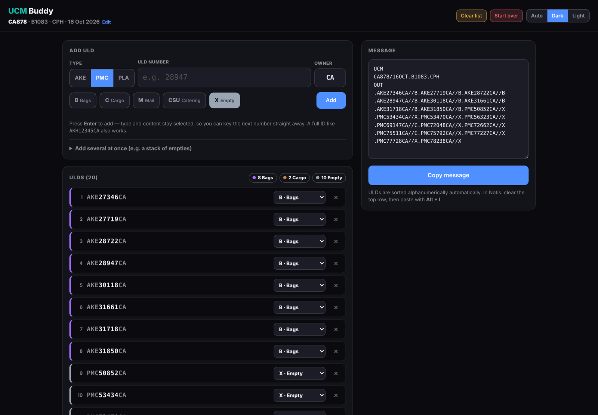
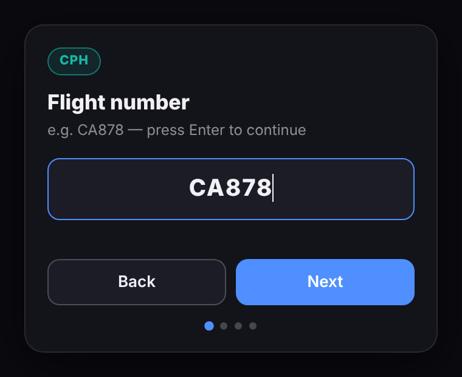
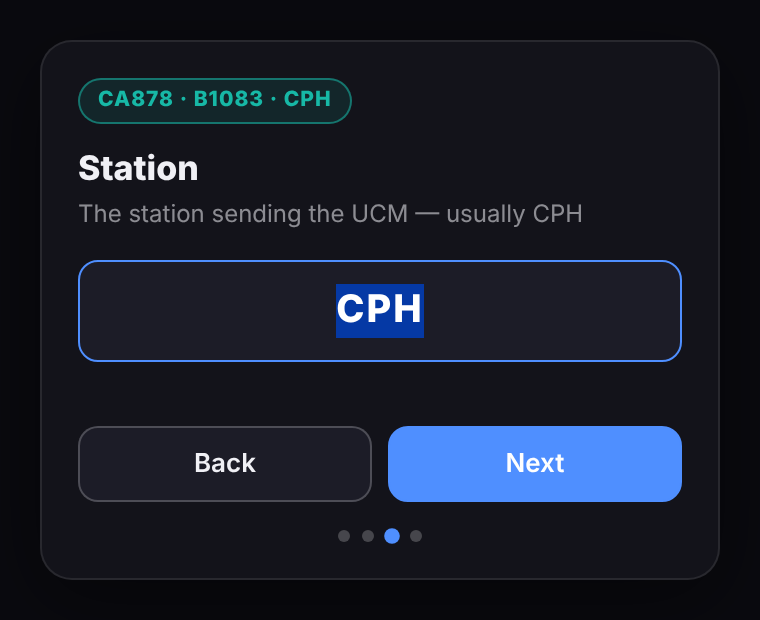
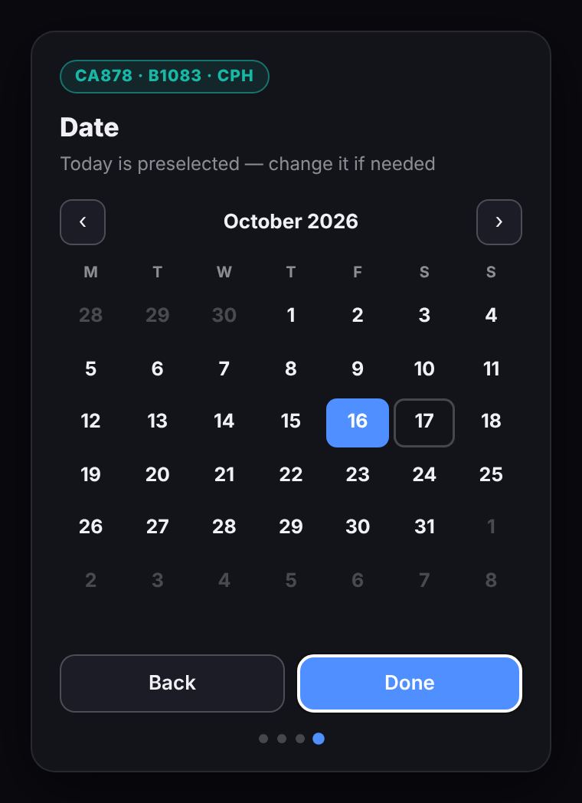
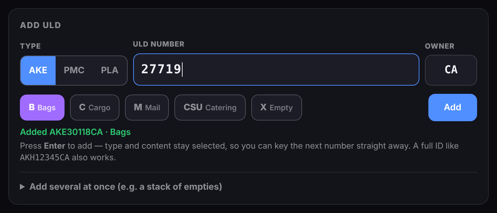
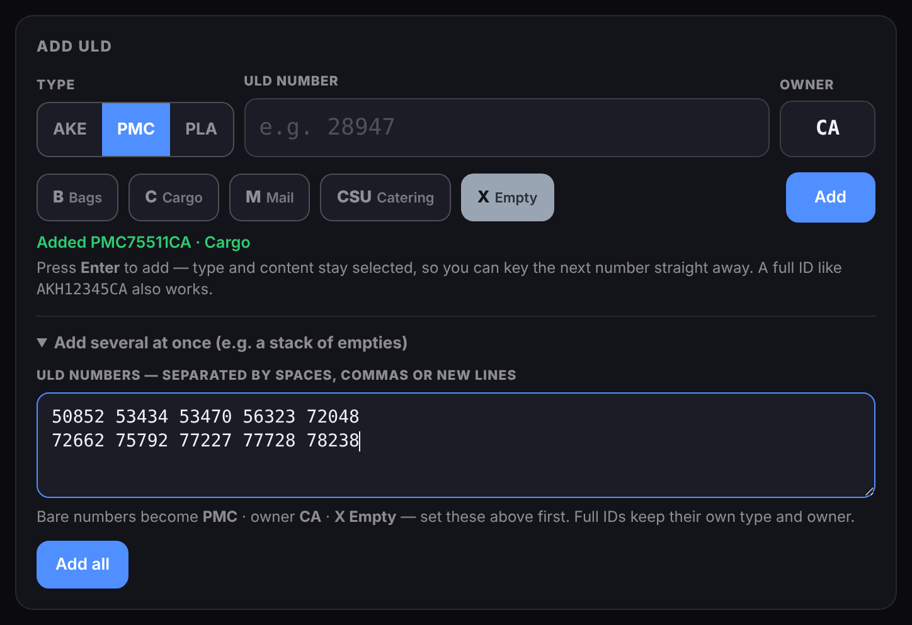
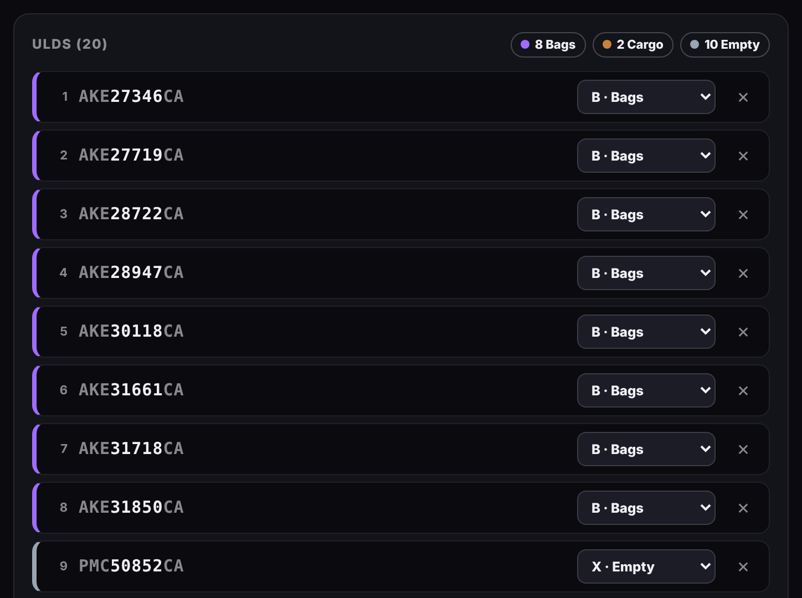
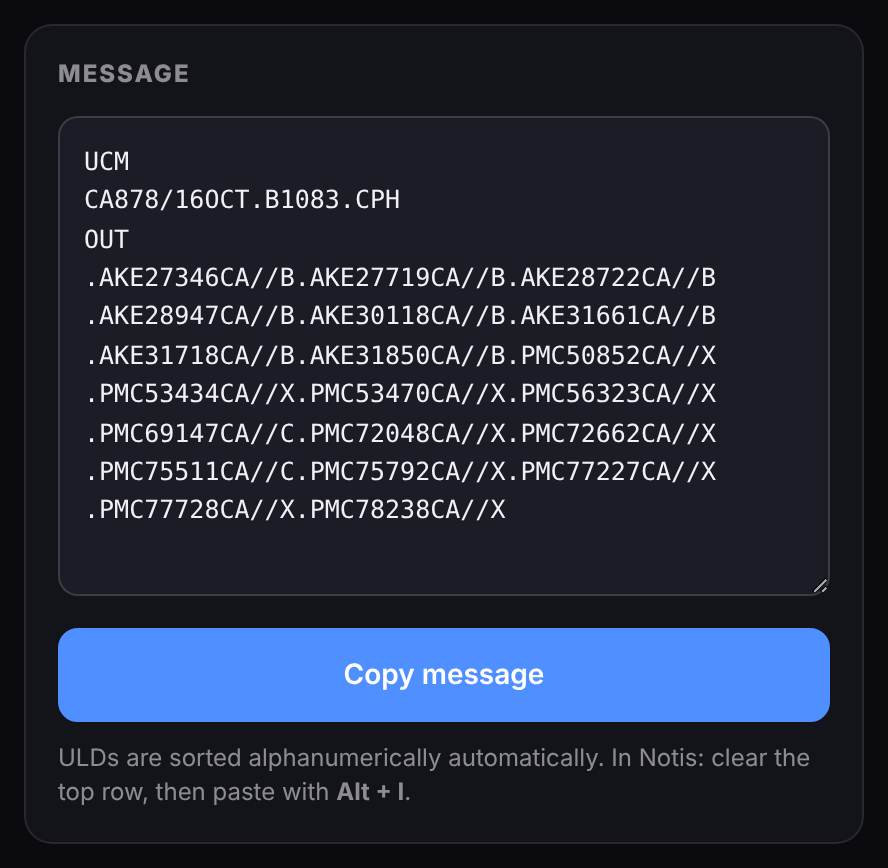
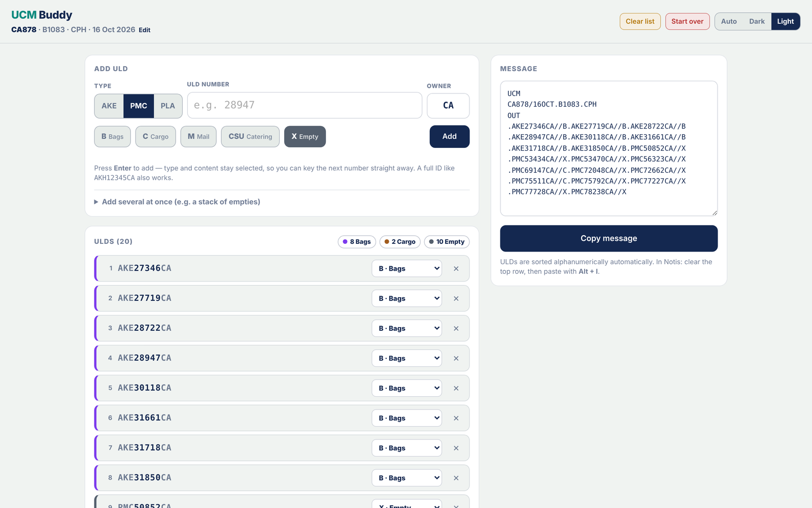

# UCM Buddy

Builds the **UCM** (ULD Control Message) for an outbound flight at Copenhagen Airport (CPH).
Type in the ULD numbers, pick what's in them, and copy a correctly formatted, alphanumerically
sorted message straight into Notis.

**Open the app:** https://kungkotz.github.io/ucmbuddy

📄 **One-page guide to print or send round:** [docs/UCMBuddy_QuickGuide.pdf](docs/UCMBuddy_QuickGuide.pdf)

Sister app to [CPM Buddy](https://kungkotz.github.io/cpmbuddy). Same look, same idea: one file, no
installs, works offline, and your work is still there after a refresh.



---

## The whole job in five moves

1. **Flight details** — flight number, registration, station, date.
2. **Add the ULDs** — type each number, press Enter.
3. **Stacks of empties** — paste them all in one go.
4. **Check the list** — fix a content code or remove a ULD if needed.
5. **Copy** — paste into Notis.

---

## Step by step

### 1 · Start and enter the flight

Open the app and tap **UCM Buddy**. A short wizard asks for one thing at a time — press **Enter** to move on.

| | |
|---|---|
|  | **Flight number** — e.g. `CA878`. A leading zero is fine; `CA0878` becomes `CA878` in the message. The airline code (CA) becomes the default ULD owner. |
|  | **Registration**, then **station** — the station is already filled in as `CPH`, so just press Enter. |
|  | **Date** — today is preselected. Tap another day if needed, then **Done**. |

You can change any of these later: tap the flight line under the **UCM Buddy** title.

### 2 · Add the ULDs one by one



1. Pick the **type** — AKE, PMC or PLA.
2. Pick the **content**:

   | Code | Meaning |
   |------|---------|
   | **B** | Bags |
   | **C** | Cargo |
   | **M** | Mail |
   | **CSU** | Catering |
   | **X** | Empty |

3. Type the **ULD number** and press **Enter**.

Type and content stay selected after each one, so eight bag containers is just eight numbers and
eight Enters. Switch the type or content only when the next group is different.

- The **owner** code is filled in from the flight. Change it for a borrowed ULD.
- Another type or owner? Type the full ID instead, e.g. `AKH12345KL`.
- Adding the same ULD twice is blocked.

### 3 · Add a stack of empties in one go



A pallet of stacked empties can be ten or more ULDs. Instead of typing them one at a time:

1. Set the type to **PMC** and the content to **X**.
2. Open **Add several at once**.
3. Type or paste all the numbers, separated by spaces, commas or new lines.
4. Tap **Add all**.

Any ULD already in the list is skipped and reported, so nothing gets added twice.

### 4 · Check the list



The list is always sorted alphanumerically, in exactly the order it goes into the message. The coloured
chips at the top count each kind.

- **Wrong content?** Change it in the dropdown on that row.
- **Wrong ULD?** Remove it with **×** and add it again.

### 5 · Copy the message



The message on the right updates as you type. Tap **Copy message**, then paste it into Notis.

---

## Sending it in Notis

1. In **DTO**, open the **UCM** on the flight and press **View**.
2. Click into the top row of the **Message text** window and delete what is already there.
3. Press **Alt + I** to paste.
4. Press **F3** to save (or the **X**, then **Yes**), then **Send**.

---

## What the message looks like

```
UCM
CA878/16OCT.B1083.CPH
OUT
.AKE27346CA//B.AKE27719CA//B.AKE28722CA//B
.AKE28947CA//B.AKE30118CA//B.AKE31661CA//B
.AKE31718CA//B.AKE31850CA//B.PMC50852CA//X
.PMC53434CA//X.PMC53470CA//X.PMC56323CA//X
.PMC69147CA//C.PMC72048CA//X.PMC72662CA//X
.PMC75511CA//C.PMC75792CA//X.PMC77227CA//X
.PMC77728CA//X.PMC78238CA//X
```

- **Header:** flight / date with month . registration . station — e.g. `CA878/16OCT.B1083.CPH`.
- **ULDs:** each one written as `.TYPE NUMBER OWNER//CODE`, three per line.
- **Order:** alphanumeric by the full ULD ID — `AKE…` before `PMC…`, lower numbers first.
- **No ULDs:** the message shows `OUT` followed by `N`.

---

## Good to know

| | |
|---|---|
| **Clear list** (amber) | Removes every ULD; keeps the flight details. Asks first. |
| **Start over** (red) | Erases everything and goes back to the flight number. Asks first. |
| **Refresh or close the tab** | Your flight and list are still there when you come back. |
| **Auto / Dark / Light** | Theme. Auto follows your computer. |
| **Phones** | Works on a phone too — the layout stacks. |



---

## Technical

- One `index.html` — vanilla HTML, CSS and JavaScript. No build step, no dependencies, works offline.
- Saved in the browser (`localStorage`) on the device only. Nothing is sent anywhere.
- Hosted on GitHub Pages. To update: upload a new `index.html` over the old one.

*Built for ground operations at Aviator, CPH.*
